#  Vertical Tabs for File Explorer

**Schede verticali come in Chrome per Esplora file di Windows 11**, con una barra delle cartelle come la barra
dei segnalibri di Chrome (con i gruppi), il ripristino delle finestre, i colori delle schede e
<kbd>Ctrl</kbd>+<kbd>Maiusc</kbd>+<kbd>T</kbd>.

[English](README.md) · **Italiano** · [Sito](https://lucasorvillo.github.io/vertical-tabs-explorer/?lang=it) ·
[Download](https://github.com/LucaSorvillo/vertical-tabs-explorer/releases/latest)

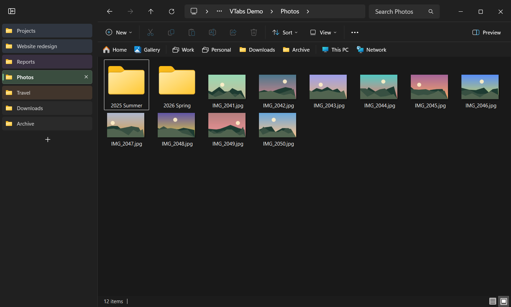

VTabsExplorer è una piccola app nella tray per Esplora file. Alcune funzioni lavorano del tutto dall'esterno:

- ricorda le finestre e le schede e le riapre;
- <kbd>Ctrl</kbd>+<kbd>Maiusc</kbd>+<kbd>T</kbd> riapre le schede chiuse;
- le cartelle aperte da altri programmi arrivano in una scheda;
- nelle cartelle lunghe compare un pulsante "Torna su".

Le **schede verticali** e la **barra delle cartelle** vanno oltre: mentre l'app è aperta, un modulo caricato in
Esplora file trasforma la barra delle schede in una colonna e il riquadro di spostamento in una barra. Sotto
restano le schede, i menu e i comandi di Esplora file.

> [!NOTE]
> L'app parla la lingua di Windows: italiano se la lingua di visualizzazione di Windows è l'italiano,
> altrimenti inglese. Lo stesso vale per l'installazione. Gli screenshot mostrano Windows in inglese.

## Funzioni

### Schede verticali

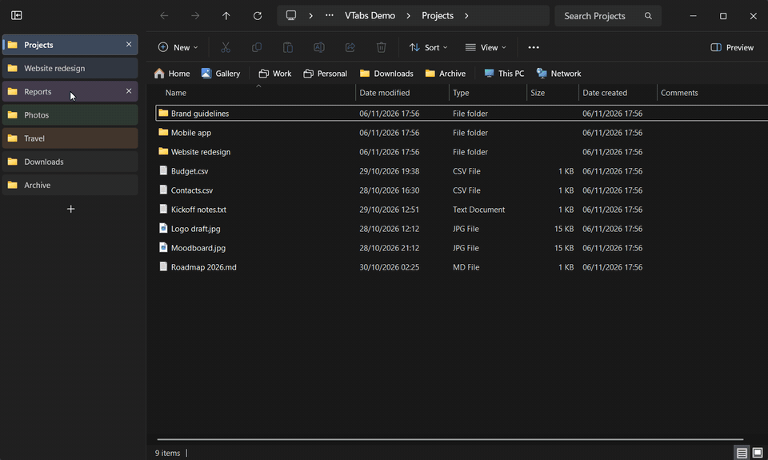

- **Una colonna dalla cima della finestra**, come le schede verticali di Chrome ed Edge. La riga del titolo,
  rimasta vuota, si nasconde: la barra degli indirizzi sale accanto ai pulsanti della finestra, e i pulsanti
  sono alti quanto la barra degli indirizzi.
- **Una cornice unica intorno alla cartella.** La barra degli indirizzi e la barra dei comandi prendono il
  colore della barra del titolo, lo stesso della colonna.
- **Lo stesso aspetto delle schede di Esplora file**: icona e titolo, con il carattere e i colori originali.
  Segue il tema chiaro e scuro.
- **Clic** per cambiare scheda, **clic centrale** o **X** per chiudere, **+** per una scheda nuova.
- **Si riordinano trascinando.** Si spostano anche le schede vere.
- **Clic destro**: il menu della scheda di Esplora file (chiudi, chiudi le altre, chiudi quelle a destra,
  duplica), più **Colore scheda**.
- **Si comprime** in sole icone con il pulsante in alto. **Si allarga** trascinando la linea divisoria (doppio
  clic per tornare alla misura iniziale). Larghezza e stato valgono per tutte le finestre.

| Colori delle schede | Colonna compressa |
| --- | --- |
| 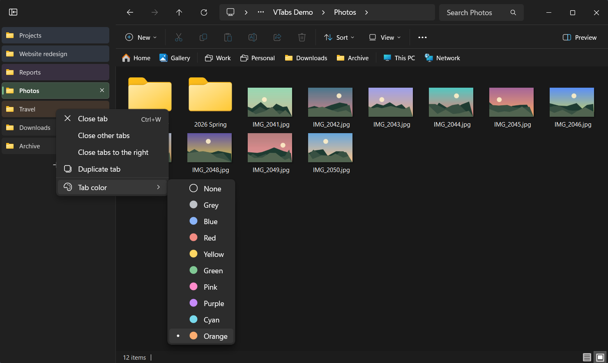 | 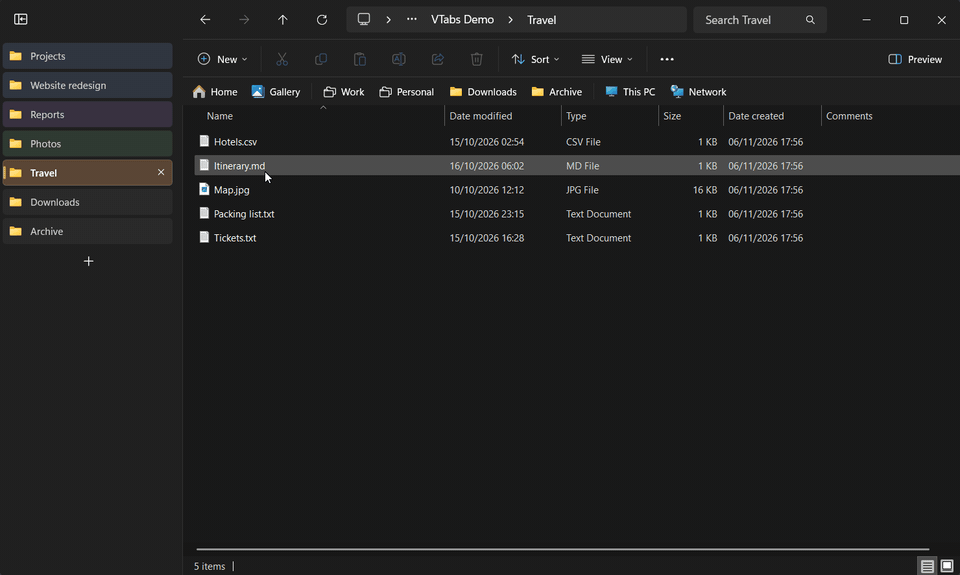 |

I **colori delle schede** sono quelli dei gruppi di schede di Chrome. Il colore appartiene alla scheda, non
alla cartella: la segue quando la si sposta o quando si passa a un'altra cartella. Si salva con la sessione e
torna con lei e con <kbd>Ctrl</kbd>+<kbd>Maiusc</kbd>+<kbd>T</kbd>.

### Barra delle cartelle, con i gruppi come le cartelle dei segnalibri di Chrome

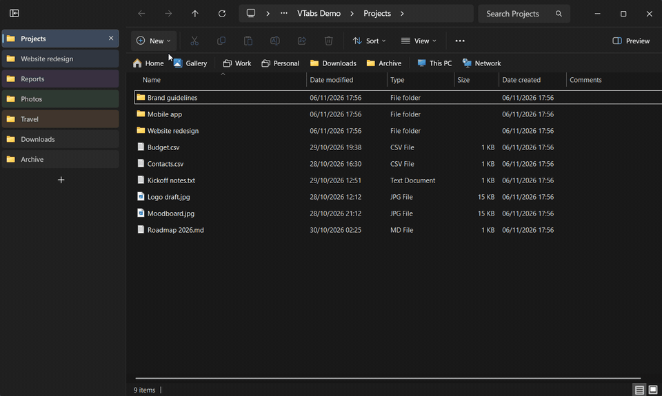

Il riquadro di spostamento diventa una barra sotto la barra dei comandi, come la barra dei segnalibri di
Chrome. Funziona con o senza le schede verticali.

- **Le stesse voci del riquadro di spostamento**, nello stesso ordine e con le stesse icone: Home, Galleria,
  OneDrive, le cartelle di Accesso rapido, Questo PC, Rete, Linux... Le voci che non ci stanno finiscono
  nell'elenco **»**.
- **Clic** apre la cartella nella scheda attuale. **Clic centrale** (o <kbd>Ctrl</kbd>+clic) la apre in una
  scheda nuova.
- **Clic destro** mostra il **menu di Windows 11**, lo stesso del riquadro di spostamento, con "Mostra altre
  opzioni" per il menu classico.
- **Le cartelle di Accesso rapido si riordinano trascinandole.** L'ordine è quello di Windows: lo seguono il
  riquadro di spostamento, la Home e il menu dell'icona sulla barra delle applicazioni.
- **Trascina una cartella da Esplora file** (o dal desktop, o da un altro programma) **sulla barra** per
  aggiungerla ad Accesso rapido proprio lì, come un link lasciato sulla barra dei segnalibri di Chrome.
  Lasciala al centro di un gruppo per metterla nel gruppo. I file non vengono accettati, e la cartella non
  viene né spostata né copiata. Windows elenca al massimo 50 cartelle di Accesso rapido, e la barra mostra
  le stesse.
- **Gruppi**: raccolgono cartelle e altri gruppi, uno dentro l'altro senza limiti.
  - Un clic su un gruppo apre il suo elenco. Con un elenco aperto, passando su un altro gruppo si apre subito
    il suo, come in Chrome.
  - Il clic centrale su un gruppo apre tutte le sue cartelle in schede nuove.
  - Il clic destro su un gruppo offre "Apri tutte", "Nuovo gruppo…", "Rinomina…" ed "Elimina gruppo".
  - I gruppi esistono solo nella barra: le cartelle restano in Accesso rapido.
- Spegnendo il riquadro di spostamento (**Visualizza** › **Mostra** › **Riquadro di spostamento**) si nasconde
  anche la barra.

| Gruppi annidati | Clic destro su una cartella |
| --- | --- |
| 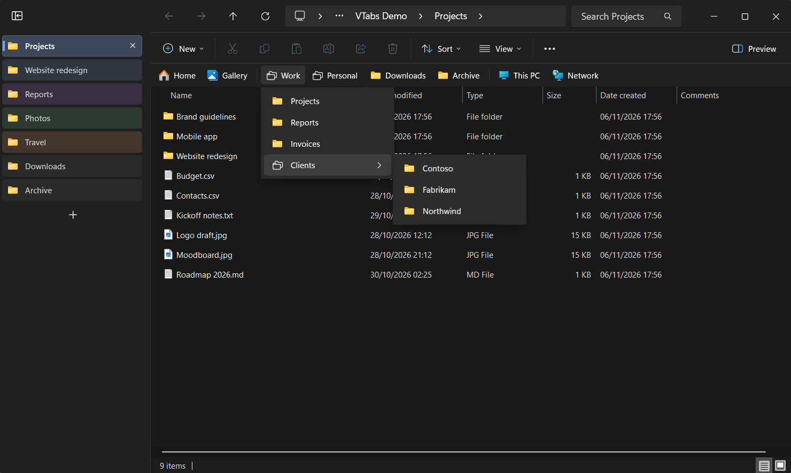 | 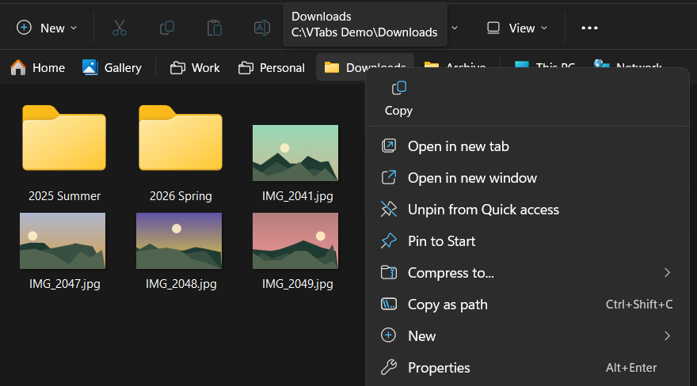 |

**Trascina una cartella su un gruppo** e fermati un attimo: il gruppo si apre, e la cartella si lascia
esattamente dove si vuole. Vale dalla barra, dall'elenco di un gruppo e da un gruppo all'altro.

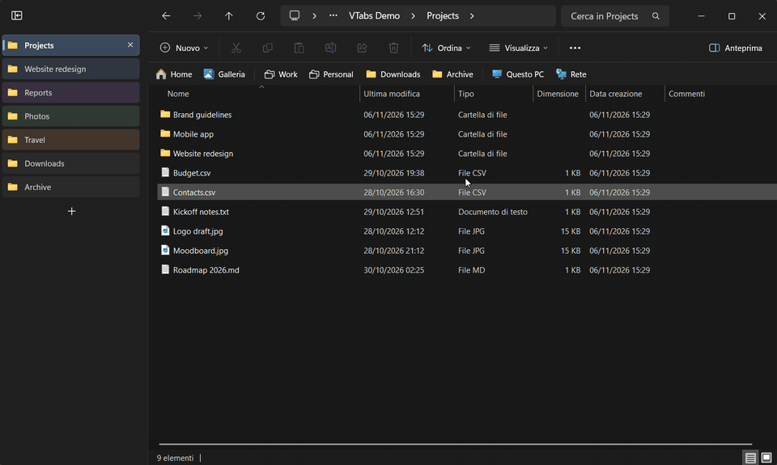

### Le finestre e le schede tornano

Esplora file dimentica tutto quando lo si chiude, si riavvia o si riavvia il PC. VTabsExplorer ricorda la
sessione di continuo:

- ogni finestra, le sue schede **nell'ordine**, la scheda attiva, i colori delle schede;
- la **posizione e la dimensione** di ogni finestra, anche ingrandita.

Riaprendo Esplora file, le finestre tornano:

- Se Esplora file si apre sulla cartella iniziale, quella finestra diventa la prima della sessione e le altre
  si riaprono dov'erano.
- Se un programma apre una cartella precisa ("Mostra nella cartella"), quella resta la scheda attiva e le schede
  della sessione si aggiungono accanto.

Ogni finestra **compare già completa**: resta invisibile mentre si costruiscono le sue schede, poi appare tutta
insieme (circa 0,3 s in più per ogni scheda in più). Le cartelle che non esistono più vengono saltate. **Riapri
ora l'ultima sessione** nel menu della tray riporta tutto quando lo si chiede.

### Riapri le schede chiuse (<kbd>Ctrl</kbd>+<kbd>Maiusc</kbd>+<kbd>T</kbd>)

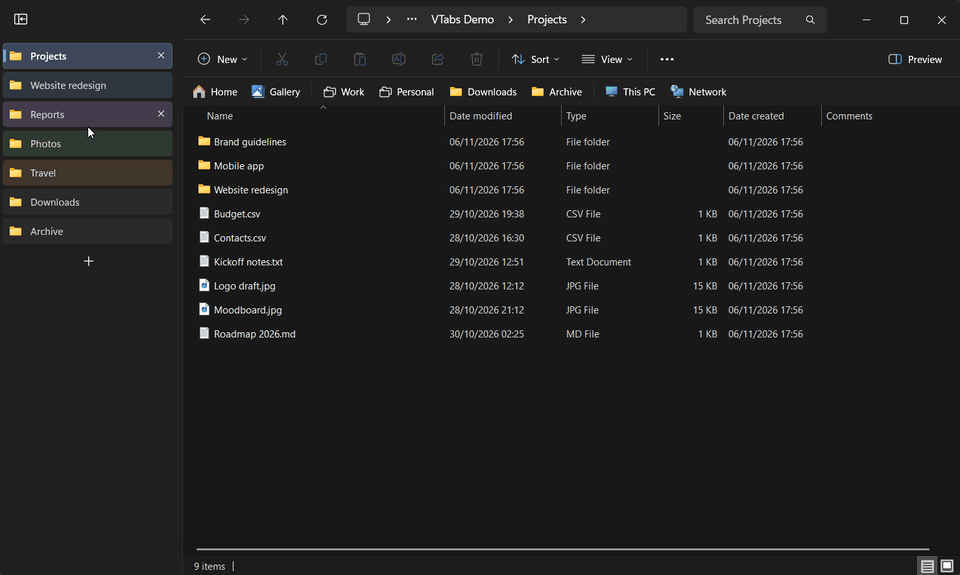

Come nel browser: la scheda chiusa torna **al suo posto**, con il suo colore, e diventa quella attiva (con le
schede verticali accese; altrimenti torna in fondo all'elenco delle schede). Se si è chiusa un'intera finestra, torna tutta la finestra, con tutte le sue schede. Premendo di nuovo si va a ritroso, fino a
25 voci. La cronologia resta anche riavviando Esplora file, l'app o il PC.

La scorciatoia si prende solo mentre è attiva una finestra di Esplora file, quindi resta libera per gli altri
programmi (il browser, per esempio).

### Le cartelle aperte da altri programmi arrivano in una scheda

Quando un altro programma apre una cartella mentre Esplora file è aperto, la cartella arriva in una **scheda
nuova** della finestra usata per ultima, come i link in Chrome. Vale per i pulsanti "Mostra nella cartella", i
collegamenti sul desktop e la ricerca di Start. Se il programma voleva mostrare un file, il file è selezionato.

<kbd>Ctrl</kbd>+<kbd>N</kbd>, "Apri in una nuova finestra", <kbd>Win</kbd>+<kbd>E</kbd> e l'icona sulla barra
delle applicazioni aprono comunque finestre nuove.

### Torna su

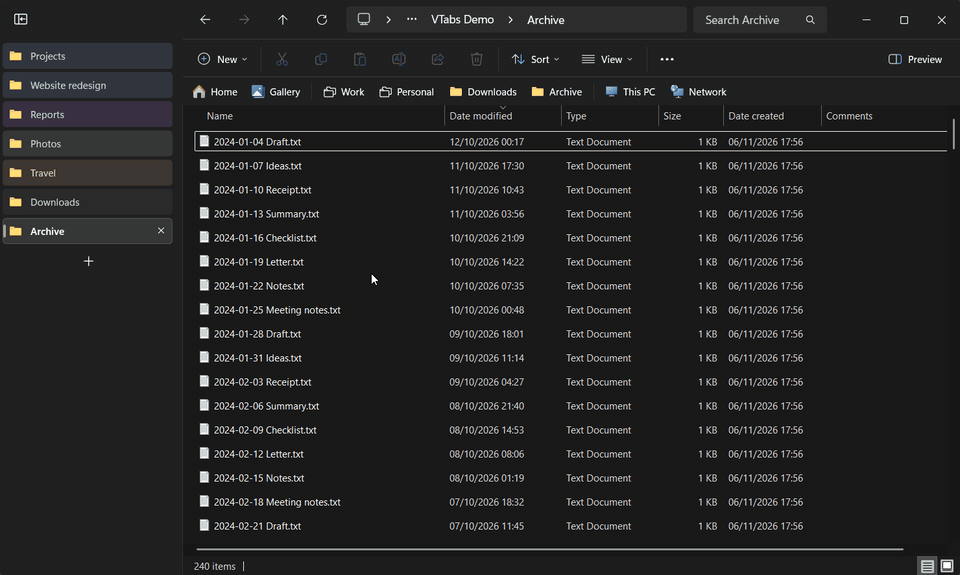

Quando una cartella scorre verso il basso, in basso a destra compare sfumando un pulsante tondo con la freccia.
Un clic riporta all'inizio senza togliere il fuoco a Esplora file.

## Requisiti

- Windows 11 a 64 bit (x64), 22H2 o successivo (l'Esplora file con le schede).
- Sviluppato e provato su Windows 11 26H2 (build 26300). Le schede verticali e la barra delle cartelle si
  appoggiano all'interfaccia interna di Esplora file: un aggiornamento di Windows potrebbe romperle. Vedi
  [Sicurezza](#sicurezza) e [Limiti](#limiti).

## Installazione

1. Scarica `VTabsExplorer-<versione>-setup.exe` dall'[ultima release](https://github.com/LucaSorvillo/vertical-tabs-explorer/releases/latest).
2. Avvialo. Non servono diritti di amministratore: si installa in `%LOCALAPPDATA%\Programs\VTabsExplorer`.
   Come l'app, l'installazione segue la lingua di Windows (italiano o inglese), e propone di:
   - avviare l'app con Windows (serve a riaprire le cartelle dopo un riavvio);
   - attivare le schede verticali;
   - attivare la barra delle cartelle.
3. L'app parte nell'area di notifica (tray). Le schede verticali e la barra delle cartelle compaiono subito
   nelle finestre di Esplora file.

> [!IMPORTANT]
> L'installer non ha una firma digitale, quindi Windows SmartScreen può mostrare "PC protetto da Windows".
> Fai clic su **Ulteriori informazioni** › **Esegui comunque**. Per le schede verticali e la barra delle
> cartelle, l'app carica un modulo dentro Esplora file: qualche antivirus potrebbe segnalarlo. Il codice
> sorgente è tutto qui, e puoi compilarlo da te.

## Uso

Tutto è nel menu della tray (clic destro sull'icona):

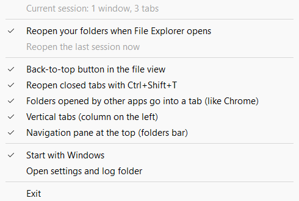

| Voce del menu | Predefinito |
| --- | --- |
| Riapri le cartelle all'apertura di Esplora file | attiva |
| Riapri ora l'ultima sessione | (quando non ci sono finestre aperte) |
| Pulsante «Torna su» nella vista dei file | attiva |
| Riapri la scheda chiusa con Ctrl+Maiusc+T | attiva |
| Cartelle aperte da altri programmi in una scheda (come Chrome) | attiva |
| Schede verticali (colonna a sinistra) | scelta nell'installazione |
| Riquadro di spostamento in alto (barra delle cartelle) | scelta nell'installazione |
| Avvia con Windows | scelta nell'installazione |
| Apri cartella impostazioni e log | |
| Esci | |

Con Windows in un'altra lingua le voci sono in inglese, come nell'immagine.

Spegnendo le schede verticali o la barra delle cartelle tornano subito la normale barra delle schede e il
riquadro di spostamento di Esplora file.

L'app accetta anche alcune opzioni da riga di comando: `--restore-now`, `--reopen-tab`, `--exit`.

## Sicurezza

Il modulo che disegna le schede verticali e la barra delle cartelle lavora dentro `explorer.exe`, che ospita
anche la barra delle applicazioni e il desktop. Per questo:

- Ogni gestore di eventi è protetto, e nessuna eccezione esce dal codice del modulo.
- L'app nella tray sorveglia ogni processo di Esplora file con il modulo. Se uno termina con un codice di
  errore, le schede verticali e la barra delle cartelle vengono **sospese subito**: un avviso lo dice, e il
  modulo non viene più caricato finché non si riattiva la funzione dal menu della tray.
- Il modulo non si può scaricare. Spegnendo la funzione torna l'interfaccia normale di Esplora file, ma il
  modulo resta caricato finché Esplora file non si riavvia. Dopo un aggiornamento, il nuovo modulo entra in
  funzione al riavvio di Esplora file (o disconnettendosi e riconnettendosi).

Ripristino della sessione, <kbd>Ctrl</kbd>+<kbd>Maiusc</kbd>+<kbd>T</kbd>, cartelle in una scheda e "Torna su"
non caricano nulla dentro Esplora file.

## Privacy

- L'app funziona offline: niente rete, niente telemetria, nessun account.
- Non legge mai il contenuto dei file. Salva i percorsi delle cartelle, perché le servono per riaprire le
  finestre.
- Tutto resta in `%LOCALAPPDATA%\VTabsExplorer`:
  - `settings.ini`: le opzioni del menu della tray, larghezza e stato della colonna.
  - `session.txt`: le finestre aperte (cartelle delle schede, posizioni, colori delle schede).
  - `closed.txt`: le ultime 25 schede o finestre chiuse (percorsi delle cartelle).
  - `navbar-groups.json`: i gruppi della barra delle cartelle.
  - `colors\`: i colori delle schede scambiati tra l'app e il modulo.
  - `logs\`: i registri diagnostici. Contengono percorsi di cartelle: controllali prima di allegarli a una
    segnalazione.
  - `runtime\`: una copia del modulo caricato in Esplora file, così l'app si può aggiornare anche con Esplora
    file aperto.

## Come funziona

`VTabsExplorer.exe` segue finestre e schede di Esplora file dall'esterno, con le interfacce COM della shell
(`IShellWindows`, `IWebBrowser2`). Le salva e ricostruisce finestre e schede quando serve. Mentre una finestra
si ricostruisce è "velata": resa trasparente con opacità zero, resta sulla barra delle applicazioni ma non si
vede finché tutte le sue schede non sono pronte.

Per le schede verticali e la barra delle cartelle carica `VTabsExplorerMod.dll` dentro `explorer.exe`
(`CreateRemoteThread` + `LoadLibraryW`). Dentro Esplora file, il modulo trova la barra delle schede WinUI 3 di
ogni finestra agganciando alcuni metodi virtuali del runtime XAML, senza l'API di diagnostica XAML. Poi
costruisce la colonna e la barra in sue isole XAML. La colonna è legata alle schede di Esplora file, e la barra
legge le stesse voci del riquadro di spostamento. `IAutomaticDestinationList` tiene l'ordine delle cartelle di
Accesso rapido allineato con Windows. Il menu di Windows 11 si apre con lo stesso componente che usa il
riquadro di spostamento.

I dettagli sono in [ARCHITECTURE.md](ARCHITECTURE.md) (in inglese). Le note di sviluppo complete, in italiano,
sono in [DESIGN-NOTES.it.md](DESIGN-NOTES.it.md).

## Compilazione

Servono:

- Windows 11 x64.
- Visual Studio 2022 o successivo con **Sviluppo di applicazioni desktop con C++**: MSVC x64, Windows SDK
  con C++/WinRT, CMake e Ninja (tutti compresi nel carico di lavoro).
- [Inno Setup 6](https://jrsoftware.org/isinfo.php), solo per l'installer.

Le proiezioni C++/WinRT si generano dal runtime Windows App SDK che carica Esplora file stesso
(`%windir%\SystemApps\Microsoft.WindowsAppRuntime.CBS*`). Nessun file Microsoft viene copiato nel repository.

```powershell
.\build.ps1                     # Release in build\bin (riavvia l'app nella tray se è aperta)
.\build.ps1 -Config Debug       # versione di debug
& "$env:LOCALAPPDATA\Programs\Inno Setup 6\ISCC.exe" installer\VTabsExplorer.iss   # installer in dist\
```

La prima compilazione scarica i metadati del pacchetto NuGet `Microsoft.Web.WebView2` (solo il suo `.winmd`),
a cui fa riferimento `Microsoft.UI.Xaml.winmd`.

`tools\test\Run-Tests.ps1` e gli script in `tools\test\vertical-tabs` sono i test automatici. Mettono l'app in
una modalità di prova che considera solo le finestre aperte dai test sulle loro cartelle di prova; i test delle
schede verticali lavorano anche in un processo `explorer.exe` separato. Le tue finestre non vengono toccate.

## Disinstallazione

**Impostazioni** › **App** › **App installate** › **Vertical Tabs for File Explorer** › **Disinstalla**. La
disinstallazione chiude l'app nella tray e chiede se eliminare anche impostazioni e dati salvati. Le finestre
già aperte tengono le schede verticali finché Esplora file non si riavvia (o fino alla disconnessione).

## Limiti

- Le schede verticali e la barra delle cartelle dipendono da come è costruito dentro Esplora file, che un
  aggiornamento di Windows può cambiare. Se qualcosa non va, spegni la funzione dal menu della tray e
  [apri una segnalazione](https://github.com/LucaSorvillo/vertical-tabs-explorer/issues) indicando la versione
  di Windows (<kbd>Win</kbd>+<kbd>R</kbd> › `winver`).
- Solo x64.

## Vedi anche

[Vertical Tabs for Notepad](https://github.com/LucaSorvillo/vertical-tabs-notepad/blob/main/README.it.md): le
stesse schede verticali per il Blocco note di Windows 11.

## Licenza

[MIT](LICENSE). Questo progetto non è affiliato a Microsoft né approvato da Microsoft. Windows ed Esplora file
sono marchi di Microsoft Corporation.
