# Vertical Tabs for File Explorer

**Chrome-style vertical tabs for Windows 11 File Explorer**, plus a folders bar like Chrome's bookmarks bar
(with groups), session restore, tab colors and <kbd>Ctrl</kbd>+<kbd>Shift</kbd>+<kbd>T</kbd>.

**English** · [Italiano](README.it.md) · [Website](https://lucasorvillo.github.io/vertical-tabs-explorer/) ·
[Download](https://github.com/LucaSorvillo/vertical-tabs-explorer/releases/latest)

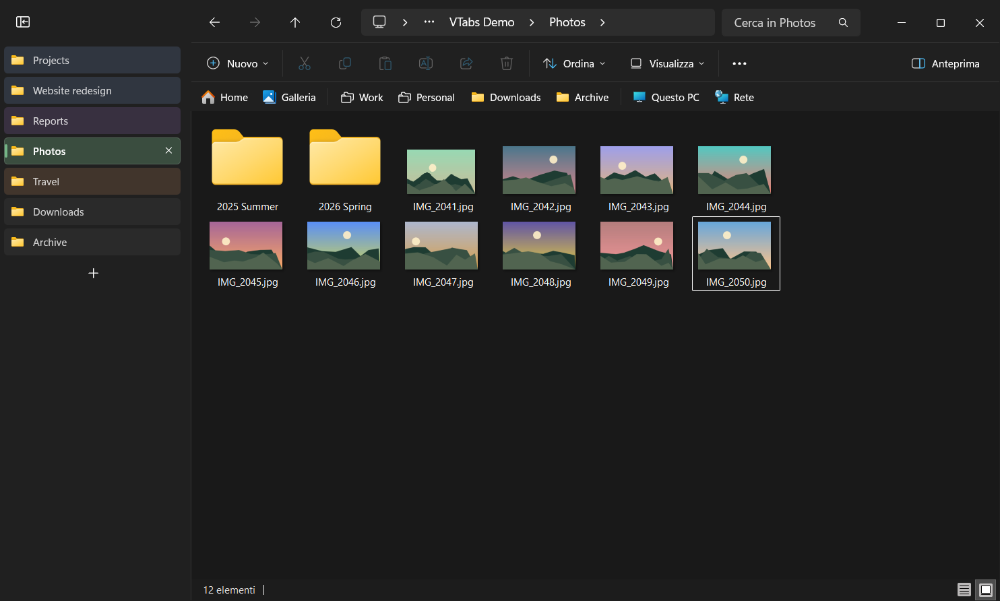

VTabsExplorer is a small tray app for File Explorer. Some features work entirely from the outside:

- it remembers your windows and tabs and reopens them;
- <kbd>Ctrl</kbd>+<kbd>Shift</kbd>+<kbd>T</kbd> reopens closed tabs;
- folders opened by other apps go into a tab;
- a "back to top" button appears in long folders.

The **vertical tabs** and the **folders bar** go further: while the app runs, a module loaded into File
Explorer rebuilds the tab strip as a column and the navigation pane as a bar. Under the hood they are still
File Explorer's own tabs, menus and commands.

> [!NOTE]
> The app's own texts (tray menu, the "Tab color" menu, the group menus) are in Italian for now. The
> screenshots show an Italian Windows.

## Features

### Vertical tabs

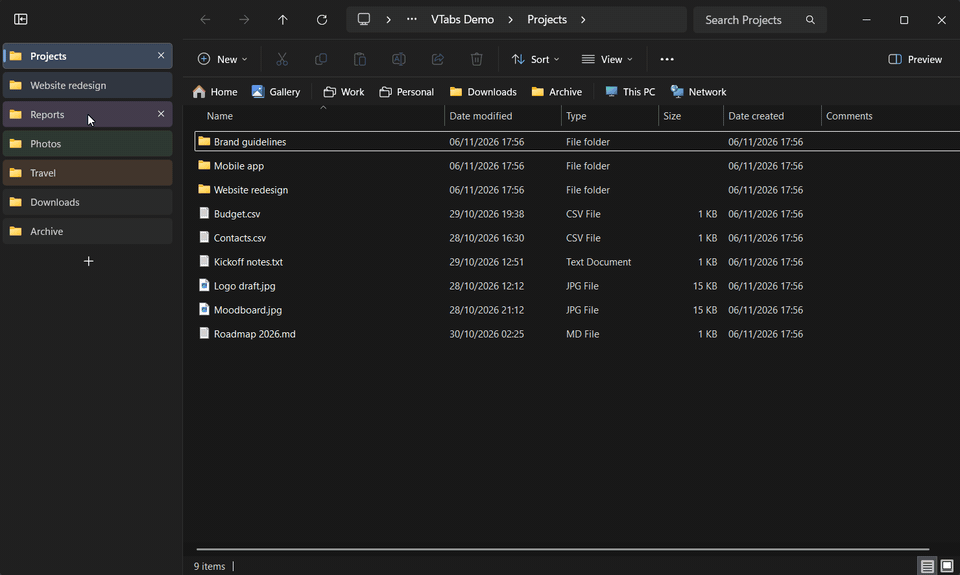

- **A column from the top of the window**, like the vertical tabs in Chrome and Edge. The empty title row is
  hidden: the address bar moves up next to the window buttons, and the window buttons are as tall as the
  address bar.
- **One frame around the folder.** The address bar and the command bar take the color of the title bar, the
  same as the column.
- **Same look as File Explorer's tabs**: icon and title, with the native font and colors. Follows the light and
  dark theme.
- **Click** to switch, **middle-click** or **X** to close, **+** for a new tab.
- **Drag to reorder.** The real tabs move too.
- **Right-click**: File Explorer's own tab menu (close, close others, close to the right, duplicate), plus
  **Tab color**.
- **Collapse** to icons with the button at the top. **Resize** by dragging the divider (double-click resets
  it). Width and state apply to all windows.

| Tab colors | Collapsed |
| --- | --- |
| 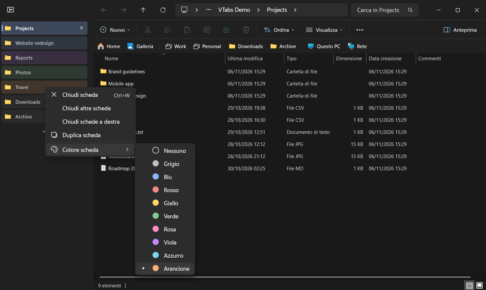 | 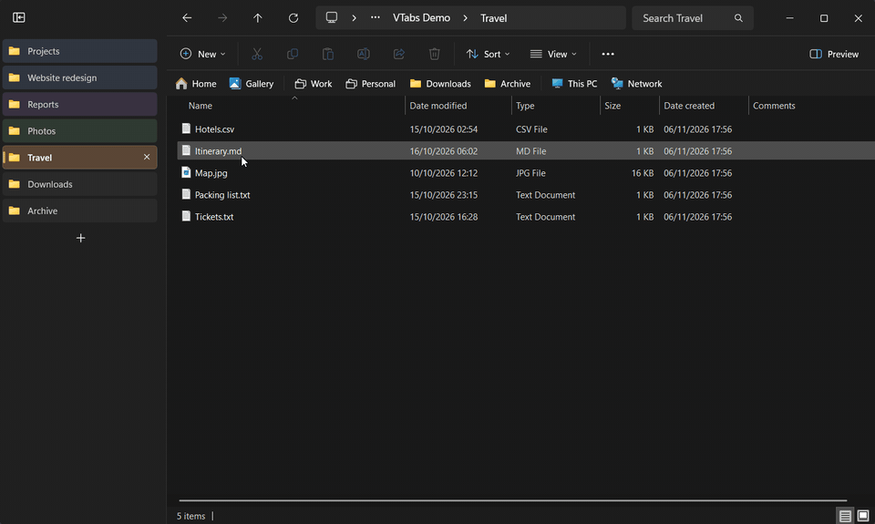 |

**Tab colors** are the colors of Chrome's tab groups. A color belongs to the tab, not to the folder: it
follows the tab when you reorder it or browse to another folder. It is saved with the session, and comes back
with it and with <kbd>Ctrl</kbd>+<kbd>Shift</kbd>+<kbd>T</kbd>.

### Folders bar, with groups like Chrome's bookmark folders

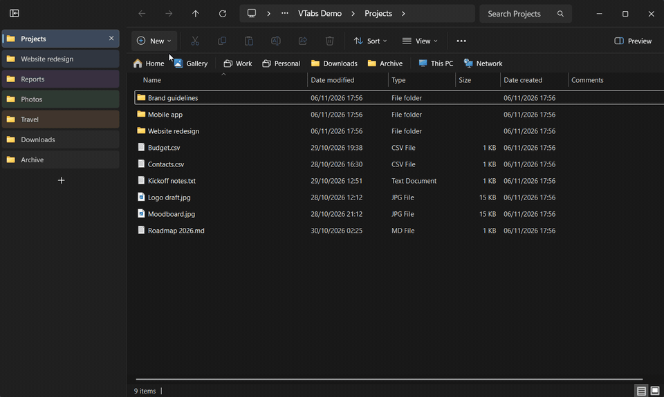

The navigation pane becomes a bar under the command bar, like Chrome's bookmarks bar. It works with or
without the vertical tabs.

- **The same items as the navigation pane**, in the same order and with the same icons: Home, Gallery,
  OneDrive, your Quick Access folders, This PC, Network, Linux... Items that don't fit go into the **»**
  list.
- **Click** opens the folder in the current tab. **Middle-click** (or <kbd>Ctrl</kbd>+click) opens it in a new
  tab.
- **Right-click** shows the **Windows 11 context menu**, the same one as the navigation pane, with "Show more
  options" for the classic menu.
- **Drag your Quick Access folders** to reorder them. The order is Windows' own: the navigation pane, Home
  and the taskbar jump list follow it.
- **Groups**: collect folders and other groups, nested as deep as you like.
  - Click a group to open its list. Once a list is open, hovering another group switches to it at once, like
    in Chrome.
  - Middle-click a group to open all its folders in new tabs.
  - Right-click a group for "Open all", "New group…", "Rename…" and "Delete group".
  - Groups exist only in the bar: the folders stay in Quick Access.
- When the navigation pane is turned off (**View** › **Show** › **Navigation pane**), the bar is hidden too.

| Nested groups | Right-click on a folder |
| --- | --- |
| 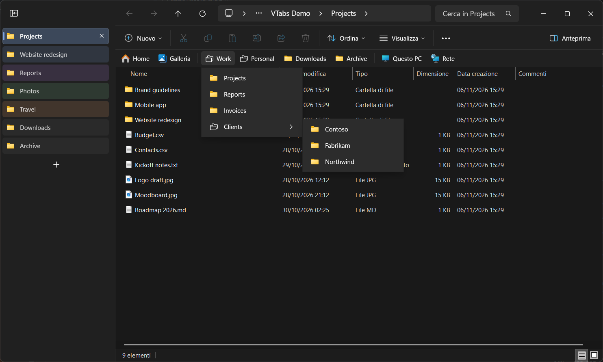 | 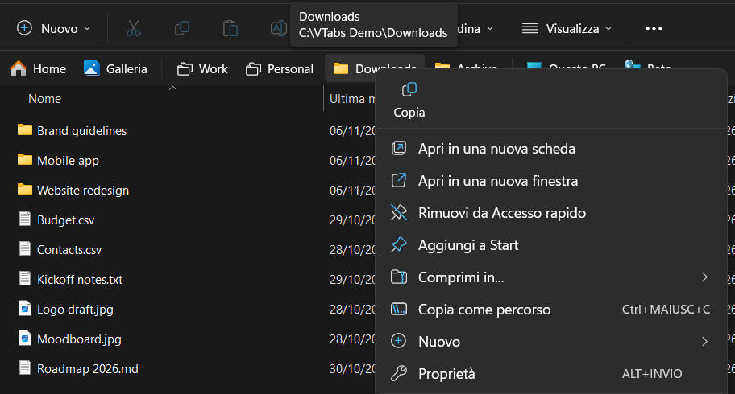 |

**Drag a folder onto a group** and stop for a moment: the group opens, and you can drop the folder exactly
where you want it. This works from the bar, from a group's list and from one group to another.

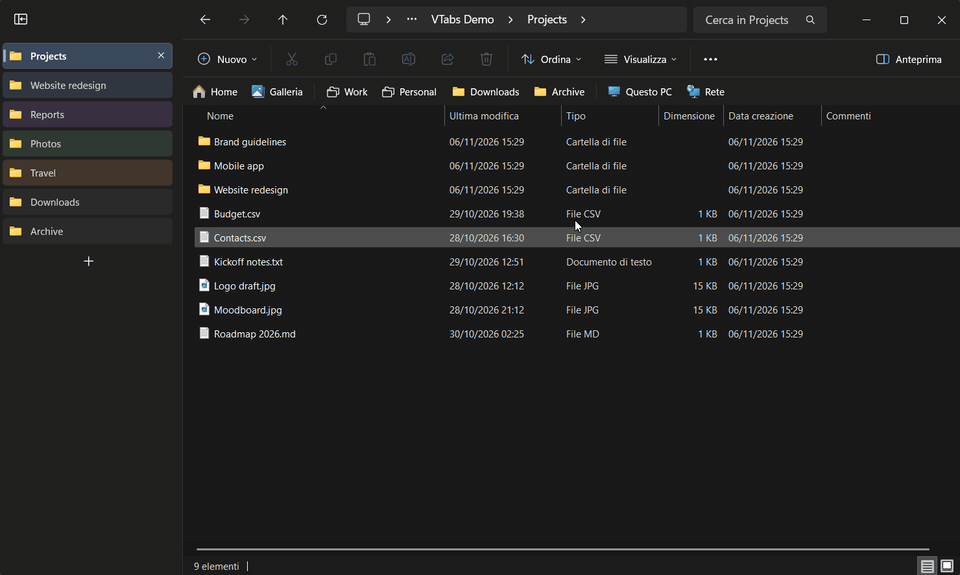

### Your windows and tabs come back

File Explorer forgets everything when you close it, restart it or restart the PC. VTabsExplorer remembers
the session continuously:

- every window, its tabs **in order**, the active tab, the tab colors;
- the **position and size** of each window, maximized included.

When you open File Explorer again, the windows come back:

- If File Explorer opens on its start folder, that window becomes the first one of the session, and the others
  reopen where they were.
- If an app opens a specific folder ("Show in folder"), that folder stays the active tab and the session's
  tabs are added next to it.

Each window **appears complete**: it stays invisible while its tabs are built, then shows up all at once
(about 0.3 s more for each extra tab). Folders that no longer exist are skipped. **Riapri ora l'ultima
sessione** ("Reopen the last session now") in the tray menu brings everything back on request.

### Reopen closed tabs (<kbd>Ctrl</kbd>+<kbd>Shift</kbd>+<kbd>T</kbd>)

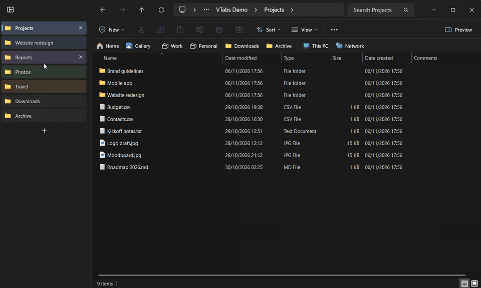

Like in a browser: the closed tab comes back as the active tab, at the end of the tab list. If you closed a
whole window, the whole window comes back, with all its tabs. Press again to go further back, up to 25
entries. The history survives restarting File Explorer, the app or the PC.

The shortcut is taken only while a File Explorer window is active, so other apps (your browser, for example)
keep it.

### Folders opened by other apps go into a tab

When another app opens a folder while File Explorer is open, the folder arrives as a **new tab** of the window
you used last, like links in Chrome. This covers "Show in folder" buttons, desktop shortcuts and Start
search. If the app wanted to show a file, the file is selected.

<kbd>Ctrl</kbd>+<kbd>N</kbd>, "Open in new window", <kbd>Win</kbd>+<kbd>E</kbd> and the taskbar icon still open
new windows.

### Back to top

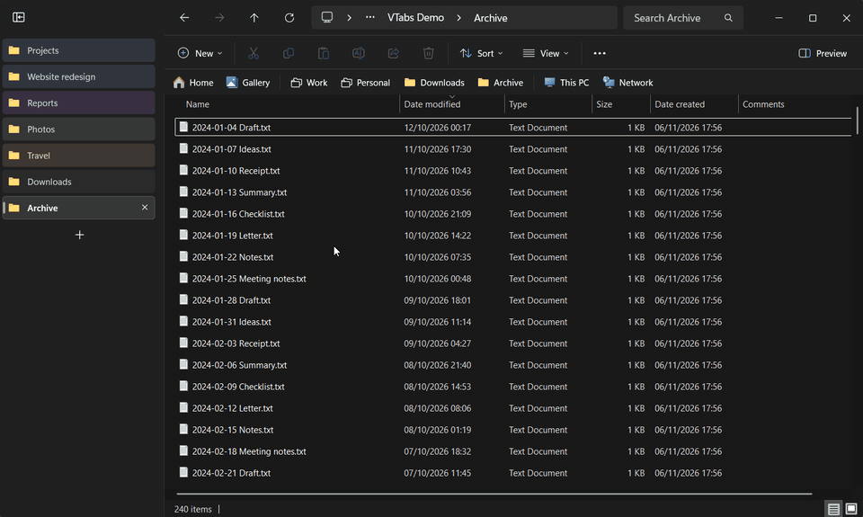

When you scroll down a folder, a round button with an arrow fades in at the bottom right. One click scrolls
back to the top without taking the focus away from File Explorer.

## Requirements

- Windows 11, 64-bit (x64), 22H2 or later (the File Explorer with tabs).
- Developed and tested on Windows 11 26H2 (build 26300). The vertical tabs and the folders bar rely on File
  Explorer's internal user interface, so a Windows update may break them. See [Safety](#safety) and
  [Limitations](#limitations).

## Installation

1. Download `VTabsExplorer-<version>-setup.exe` from the
   [latest release](https://github.com/LucaSorvillo/vertical-tabs-explorer/releases/latest).
2. Run it. No administrator rights are needed: it installs into `%LOCALAPPDATA%\Programs\VTabsExplorer`.
   The setup is in English or Italian. It offers to:
   - start the app with Windows (needed to restore your folders after a restart);
   - turn on the vertical tabs;
   - turn on the folders bar.
3. The app starts in the notification area (tray). The vertical tabs and the folders bar appear in the
   File Explorer windows right away.

> [!IMPORTANT]
> The installer isn't code-signed, so Windows SmartScreen may show "Windows protected your PC". Click
> **More info** › **Run anyway**. For the vertical tabs and the folders bar, the app loads a module into File
> Explorer: some security software may flag that behavior. The source code is all here, and you can build it
> yourself.

## Usage

Everything is in the tray menu (right-click the icon). The items are in Italian:

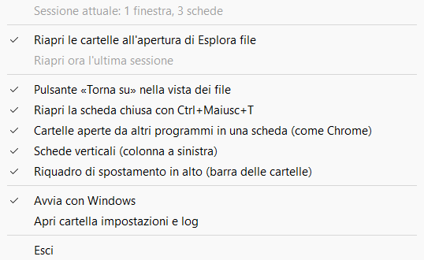

| Menu item | Meaning | Default |
| --- | --- | --- |
| Riapri le cartelle all'apertura di Esplora file | Reopen your folders when File Explorer opens | on |
| Riapri ora l'ultima sessione | Reopen the last session now (when no window is open) | |
| Pulsante «Torna su» nella vista dei file | Back-to-top button | on |
| Riapri la scheda chiusa con Ctrl+Maiusc+T | Reopen closed tabs with Ctrl+Shift+T | on |
| Cartelle aperte da altri programmi in una scheda (come Chrome) | Folders opened by other apps go into a tab | on |
| Schede verticali (colonna a sinistra) | Vertical tabs | chosen in the setup |
| Riquadro di spostamento in alto (barra delle cartelle) | Folders bar | chosen in the setup |
| Avvia con Windows | Start with Windows | chosen in the setup |
| Apri cartella impostazioni e log | Open the settings and log folder | |
| Esci | Exit | |

Turning off the vertical tabs or the folders bar brings back File Explorer's normal tab strip and navigation
pane right away.

The app also accepts a few command-line options: `--restore-now`, `--reopen-tab`, `--exit`.

## Safety

The module that draws the vertical tabs and the folders bar runs inside `explorer.exe`, which also hosts the
taskbar and the desktop. So:

- Every event handler is guarded, and no exception leaves the module's code.
- The tray app watches every File Explorer process that has the module. If one ends with a crash code, the
  vertical tabs and the folders bar are **suspended at once**: a notification says so, and the module isn't
  loaded again until you turn the feature back on from the tray menu.
- The module can't be unloaded. Turning the feature off restores File Explorer's normal interface, but the
  module stays loaded until File Explorer restarts. After an update, the new module takes effect when File
  Explorer restarts (or when you sign out and in again).

Session restore, <kbd>Ctrl</kbd>+<kbd>Shift</kbd>+<kbd>T</kbd>, folders in tabs and the back-to-top button don't
load anything into File Explorer.

## Privacy

- The app works offline: no network access, no telemetry, no accounts.
- It never reads the content of your files. It stores folder paths, because it needs them to reopen your
  windows.
- Everything stays in `%LOCALAPPDATA%\VTabsExplorer`:
  - `settings.ini`: the tray menu options, the column width and state.
  - `session.txt`: the open windows (folders of their tabs, positions, tab colors).
  - `closed.txt`: the last 25 closed tabs or windows (folder paths).
  - `navbar-groups.json`: the groups of the folders bar.
  - `colors\`: tab colors exchanged between the tray app and the module.
  - `logs\`: diagnostic logs. They contain folder paths: have a look before sharing them in an issue.
  - `runtime\`: a copy of the module loaded into File Explorer, so the app can be updated while File Explorer
    runs.

## How it works

`VTabsExplorer.exe` follows File Explorer windows and tabs from the outside with the shell's COM interfaces
(`IShellWindows`, `IWebBrowser2`). It saves them and rebuilds windows and tabs when needed. While a window is
being rebuilt it is "veiled": layered with zero opacity, so it stays in the taskbar but can't be seen until all
its tabs are ready.

For the vertical tabs and the folders bar, it loads `VTabsExplorerMod.dll` into `explorer.exe`
(`CreateRemoteThread` + `LoadLibraryW`). Inside File Explorer, the module finds each window's WinUI 3 tab bar
by hooking a few virtual methods of the XAML runtime, without the XAML diagnostics API. It then builds the
column and the bar in its own XAML islands. The column is bound to File Explorer's tabs, and the bar reads the
same items as the navigation pane. `IAutomaticDestinationList` keeps the order of your Quick Access folders in
sync with Windows. The Windows 11 context menu is shown through the same presenter that the navigation pane
uses.

The details are in [ARCHITECTURE.md](ARCHITECTURE.md). The full development notes (in Italian) are in
[DESIGN-NOTES.it.md](DESIGN-NOTES.it.md).

## Building from source

You need:

- Windows 11 x64.
- Visual Studio 2022 or later with **Desktop development with C++**: MSVC x64, Windows SDK with C++/WinRT,
  CMake and Ninja (all included in the workload).
- [Inno Setup 6](https://jrsoftware.org/isinfo.php), only for the installer.

The C++/WinRT projections are generated from the Windows App SDK runtime that File Explorer itself loads
(`%windir%\SystemApps\Microsoft.WindowsAppRuntime.CBS*`). No Microsoft file is copied into the repository.

```powershell
.\build.ps1                     # Release build in build\bin (restarts the tray app if it is running)
.\build.ps1 -Config Debug       # debug build
& "$env:LOCALAPPDATA\Programs\Inno Setup 6\ISCC.exe" installer\VTabsExplorer.iss   # installer in dist\
```

The first build downloads the metadata of the `Microsoft.Web.WebView2` NuGet package (only its `.winmd`),
which `Microsoft.UI.Xaml.winmd` refers to.

`tools\test\Run-Tests.ps1` and the scripts in `tools\test\vertical-tabs` are the automated tests. They put the
app in a test mode that only handles the windows they open on their own test folders; the vertical-tabs tests
also run in a separate `explorer.exe` process. Your own windows stay untouched.

## Uninstall

**Settings** › **Apps** › **Installed apps** › **Vertical Tabs for File Explorer** › **Uninstall**. The
uninstaller closes the tray app and asks whether to delete the settings and saved data too. Windows that are
open keep the vertical tabs until File Explorer restarts (or until you sign out).

## Limitations

- The vertical tabs and the folders bar depend on how File Explorer is built inside, which a Windows update
  can change. If something looks wrong, turn the feature off from the tray menu, and please
  [open an issue](https://github.com/LucaSorvillo/vertical-tabs-explorer/issues) with your Windows version
  (<kbd>Win</kbd>+<kbd>R</kbd> › `winver`).
- A reopened tab comes back at the end of the tab list, not in its old place.
- The app's texts are in Italian.
- x64 only.

## Related

[Vertical Tabs for Notepad](https://github.com/LucaSorvillo/vertical-tabs-notepad): the same vertical tabs
for the Windows 11 Notepad.

## License

[MIT](LICENSE). This project isn't affiliated with or endorsed by Microsoft. Windows and File Explorer are
trademarks of Microsoft Corporation.
